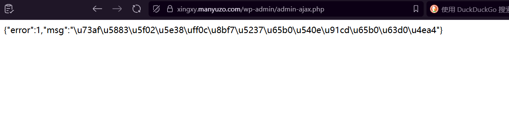

# 后台管理面板 UX 增强

## 概述

增强精灵后台管理面板（Nebuluxe Center）的用户列表和卡密管理的交互体验。包括：邀请人信息外露到列表、邀请人/站点用户可点击跳转、卡密一键复制。

## 涉及仓库

| 仓库 | 改动文件 |
|------|---------|
| **zibll-oauth-main** (插件) | `includes/util.php` |
| **tgbot-verify** (精灵) | `database_mysql.py`, `oauth_server.py`, `internal_api/routes_users.py` |
| **vue-vben-admin** (前端) | `apps/web-ele/src/api/jingling.ts`, `apps/web-ele/src/views/jingling/users.vue`, `apps/web-ele/src/views/jingling/cards.vue` |

## 功能详情

### 1. 用户列表增加「邀请人」列

在外部表格（最后签到列之后）新增**邀请人**列，显示邀请人的 TG `@username`，可点击跳转 `https://t.me/{username}`。

- 有 username → 蓝色 `@username` 链接
- 有 invited_by 但无 username → 灰色显示 TG UID
- 无邀请人 → 灰色 `—`

**实现**：内部 API `list_users` / `get_user` 的 SQL 增加 `LEFT JOIN users inv ON u.invited_by = inv.user_id`，提取 `inv.username AS inviter_username`。

### 2. 用户详情弹窗增加「站点用户」

替换原来的「WP OpenID」行为「站点用户」行：

- 已绑定且有 wp_uid → 蓝色可点击的 `wp_display_name`，跳转 `https://xingxy.manyuzo.com/author/{wp_uid}`
- 有 wp_openid 但无 wp_uid → 灰色显示 openid
- 未绑定 → 灰色「未绑定」

### 3. 数据库新增列

`tgbot_verify.users` 表新增两列：

| 列名 | 类型 | 说明 |
|------|------|------|
| `wp_uid` | INT NULL | WordPress 用户 ID |
| `wp_display_name` | VARCHAR(255) NULL | WordPress 显示名 |

### 4. 绑定流程存储 WP 用户信息

- **zibll-oauth** `userinfo` 接口新增返回 `uid`（`$user->ID`）
- **精灵** `oauth_server.py` 提取 `uid` + `name` 传入 `bind_wp_account()`
- **精灵** `database_mysql.py` 的 `bind_wp_account()` 新增 `wp_uid`、`wp_display_name` 可选参数

### 5. 已有用户回填

通过 zibll-oauth `/user/profile` 端点（签名 `md5(appid + openid + appkey)`）批量查询已绑定用户的 WP 信息并回填：

| TG UID | WP UID | 显示名 |
|--------|--------|--------|
| 1861667385 | 1 | 小芽妹 |
| 6120815938 | 55 | Melissa Parekh |
| 8480351364 | 6 | 酷猫猫 |

### 6. 卡密一键复制

卡密管理页面的卡密码显示为蓝色可点击样式，点击即复制到剪贴板并弹出「已复制：xxx」提示。支持 `navigator.clipboard` + `execCommand('copy')` 双降级。

### 7. 解绑清零积分

`/unbind` 解绑时自动清零用户积分余额（`add_balance(tg_uid, -old_balance)`）。解绑前向用户展示警告，管理员通知中包含当前余额信息。

### 8. 积分负数调整修复

修复后台调整积分输入负数时报 `Invalid signature` 的问题。根因：API Gateway 的 `_call_jingling` 对 PUT/POST/DELETE 请求未传 `tg_uid` 查询参数，导致内部 API 签名校验失败。修复方式：所有 HTTP 方法统一携带 `tg_uid` 查询参数。

## 数据流

```
绑定时：
  WP userinfo → {openid, uid, name} → 精灵 oauth_server
    → DB: wp_openid + wp_uid + wp_display_name

后台列表：
  前端 → Gateway → 内部 API
    → SQL LEFT JOIN users inv → inviter_username
    → 返回 wp_uid, wp_display_name, inviter_username

卡密复制：
  点击卡密码 → clipboard.writeText() → ElMessage 提示
```

## 更新日期

2026-05-15
